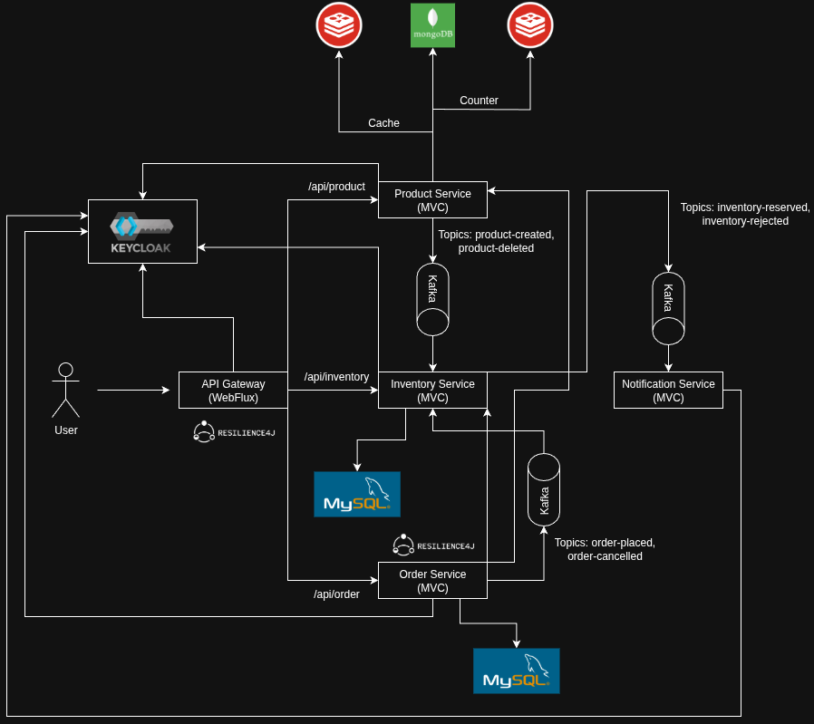

# Микросервисная архитектура интернет-магазина

Система автоматизации продаж компьютерной и офисной техники на микросервисах.

Клонируется и запускается через Docker Compose.

## 🏗️ Общая архитектура



## ⚙️ Технологии

- Spring Boot (MVC и WebFlux)
- Kafka и Schema Registry
- Redis
- MySQL и MongoDB
- Flyway (миграции базы данных)
- Docker и Docker Compose
- Resilience4j
- Keycloak (OAuth2 / OpenID Connect)
- Spring Security
- Wiremock, Mockito, Testcontainers (тестирование)

## 👥 Роли и права доступа

В realm `microservices-realm` предусмотрены роли, соответствующие бизнес-процессам магазина:

| Роль | Назначение | Основные права |
|------|------------|----------------|
| `SELLER` | Продавец-консультант | Оформление заказа, принятие/отклонение, перевод на оплату, скидка до 5 % |
| `CASHIER` | Кассир | Регистрация оплаты (наличными / картой), чек |
| `STOREKEEPER` | Кладовщик | Готовность к выдаче, выдача товара, изменение остатков |
| `MANAGER` | Руководитель | Утверждение повышенной скидки, отчёты, журнал аудита, все операции |
| `PRODUCT_MANAGER` | Техническая роль | Управление каталогом товаров (CRUD) |
| `INVENTORY_MANAGER` | Техническая роль | Управление остатками |

Тестовый пользователь `test-user` (пароль `password`) наделён всеми ролями, чтобы можно было пройти весь жизненный цикл заказа из веб-интерфейса.

## 🖥️ Веб-интерфейс

Веб-интерфейс (`web-ui`, nginx, порт `3000`) реализует все возможности API:

- **Каталог** — список товаров и карточка товара (`GET /api/product/{id}`)
- **Товары** — создание, редактирование, удаление (`POST/PUT/DELETE /api/product`)
- **Остатки** — просмотр и изменение количества (`GET/PUT /api/inventory`)
- **Заказы** — создание заказа с позициями, покупателем и скидкой (`POST /api/order`), полный жизненный цикл: принять → к оплате → оплатить (наличными/картой) → готов к выдаче → выдать, отклонение, журнал по заказу
- **Мои заказы** — список и детали своих заказов, отмена (`GET /api/order/my`, `DELETE /api/order/my/{id}`)
- **Уведомления** — журнал уведомлений и задачи на обзвон, фильтр по номеру заказа
- **Отчёт** — сводка по заказам с фильтром по статусу (`GET /api/order/report?status=...`)
- **Журнал действий** — общий журнал аудита и журнал по конкретному заказу

## 🧩 Состав сервисов

Все сервисы лежат в этом же репозитории (монорепозиторий):

| Модуль | Каталог | Назначение |
|--------|---------|------------|
| API Gateway | [`api-gateway/`](./api-gateway) | Маршрутизация запросов, проверка JWT |
| Product Service | [`product-service/`](./product-service) | Каталог товаров |
| Order Service | [`order-service/`](./order-service) | Оформление и жизненный цикл заказов |
| Inventory Service | [`inventory-service/`](./inventory-service) | Складские остатки, резервирование |
| Notification Service | [`notification-service/`](./notification-service) | Email-уведомления, журнал, задачи на обзвон |
| Web UI | [`web-ui/`](./web-ui) | Веб-интерфейс (nginx + vanilla JS) |

Инфраструктура (поднимается из `docker-compose.yaml`):

- **Keycloak** (https://www.keycloak.org/) — аутентификация и авторизация
- **Kafka + Schema Registry** (https://kafka.apache.org/) — асинхронный обмен сообщениями
- **Kafka UI** (https://www.kafkaui.com/) — веб-интерфейс для просмотра топиков и групп потребителей
- **Redis** (https://redis.io/) — кэширование и идемпотентность
- **MySQL / MongoDB** (https://www.mysql.com/, https://www.mongodb.com/) — хранение данных

## ⚙️ Переменные окружения

### 🛒 Product Service

| Переменная | Описание | Пример значения |
|------------|----------|-----------------|
| `REDIS_CACHE_HOST` | Хост Redis для кэша товаров | `redis-cache-product` |
| `REDIS_CACHE_PORT` | Порт Redis для кэша товаров | `6379` |
| `REDIS_COUNTER_HOST` | Хост Redis для счётчика товаров | `redis-counter-product` |
| `REDIS_COUNTER_PORT` | Порт Redis для счётчика товаров | `6379` |
| `DB_HOST` | Хост MongoDB | `mongodb-product` |
| `DB_PORT` | Порт MongoDB | `27017` |
| `DB_USERNAME` | Имя пользователя MongoDB | `root` |
| `DB_PASSWORD` | Пароль MongoDB | `password` |
| `AUTH_SERVER_URL` | Адрес сервера авторизации Keycloak | `http://keycloak:8080` |
| `AUTH_SERVER_REALM` | Realm Keycloak | `microservices-realm` |
| `KAFKA_BOOTSTRAP_SERVERS` | Адреса брокеров Kafka | `kafka-1:9092,kafka-2:9092` |
| `SCHEMA_REGISTRY_URL` | Адрес Schema Registry | `http://schema-registry:8081` |

### 🧾 Order Service

| Переменная | Описание | Пример значения |
|------------|----------|-----------------|
| `INVENTORY_URL` | Адрес Inventory Service | `http://inventory-service:8082` |
| `PRODUCT_URL` | Адрес Product Service | `http://product-service:8080` |
| `DB_HOST` | Хост MySQL | `mysql-order` |
| `DB_PORT` | Порт MySQL | `3306` |
| `DB_USERNAME` | Имя пользователя MySQL | `root` |
| `DB_PASSWORD` | Пароль MySQL | `password` |
| `AUTH_SERVER_URL` | Адрес сервера авторизации Keycloak | `http://keycloak:8080` |
| `AUTH_SERVER_REALM` | Realm Keycloak | `microservices-realm` |
| `KAFKA_BOOTSTRAP_SERVERS` | Адреса брокеров Kafka | `kafka-1:9092,kafka-2:9092` |
| `SCHEMA_REGISTRY_URL` | Адрес Schema Registry | `http://schema-registry:8081` |

### 📦 Inventory Service

| Переменная | Описание | Пример значения |
|------------|----------|-----------------|
| `REDIS_IDEMPOTENCY_HOST` | Хост Redis для идемпотентности | `redis-idempotency-inventory` |
| `REDIS_IDEMPOTENCY_PORT` | Порт Redis для идемпотентности | `6379` |
| `DB_HOST` | Хост MySQL | `mysql-inventory` |
| `DB_PORT` | Порт MySQL | `3306` |
| `DB_USERNAME` | Имя пользователя MySQL | `root` |
| `DB_PASSWORD` | Пароль MySQL | `password` |
| `AUTH_SERVER_URL` | Адрес сервера авторизации Keycloak | `http://keycloak:8080` |
| `AUTH_SERVER_REALM` | Realm Keycloak | `microservices-realm` |
| `KAFKA_BOOTSTRAP_SERVERS` | Адреса брокеров Kafka | `kafka-1:9092,kafka-2:9092` |
| `SCHEMA_REGISTRY_URL` | Адрес Schema Registry | `http://schema-registry:8081` |

### 📬 Notification Service

| Переменная | Описание | Пример значения |
|------------|----------|-----------------|
| `REDIS_IDEMPOTENCY_HOST` | Хост Redis для идемпотентности | `redis-idempotency-notification` |
| `REDIS_IDEMPOTENCY_PORT` | Порт Redis для идемпотентности | `6379` |
| `KAFKA_BOOTSTRAP_SERVERS` | Адреса брокеров Kafka | `kafka-1:9092,kafka-2:9092` |
| `SCHEMA_REGISTRY_URL` | Адрес Schema Registry | `http://schema-registry:8081` |
| `MAIL_HOST` | Хост SMTP-сервера | `sandbox.smtp.mailtrap.io` |
| `MAIL_PORT` | Порт SMTP-сервера | `2525` |
| `MAIL_USERNAME` | Имя пользователя SMTP | `<логин из личного кабинета Mailtrap>` |
| `MAIL_PASSWORD` | Пароль SMTP | `<пароль из личного кабинета Mailtrap>` |

### 🌐 API Gateway

| Переменная | Описание | Пример значения |
|------------|----------|-----------------|
| `INVENTORY_URL` | Адрес Inventory Service | `http://inventory-service:8082` |
| `PRODUCT_URL` | Адрес Product Service | `http://product-service:8080` |
| `ORDER_URL` | Адрес Order Service | `http://order-service:8081` |
| `NOTIFICATION_URL` | Адрес Notification Service | `http://notification-service:8083` |
| `AUTH_SERVER_URL` | Адрес сервера авторизации Keycloak | `http://keycloak:8080` |
| `AUTH_SERVER_REALM` | Realm Keycloak | `microservices-realm` |

## ⚡ Пример работы через curl

### 1. Получение токена доступа

```bash
curl -X POST http://localhost:8088/realms/microservices-realm/protocol/openid-connect/token \
-d "grant_type=password" \
-d "client_id=admin-cli" \
-d "username=test-user" \
-d "password=password"
```

В ответе в поле `access_token` придёт JWT-токен. Его нужно передавать в последующих запросах в заголовке `Authorization: Bearer <JWT_TOKEN>`.

> **Примечание:** токен действует ограниченное время (обычно несколько минут).
> Если запросы начинают возвращать `401 Unauthorized`, просто получите новый токен.

### 2. Создание товара

```bash
curl -X POST http://localhost:9000/api/product \
-H "Authorization: Bearer <JWT_TOKEN>" \
-H "Content-Type: application/json" \
-d '{"sku": "NB-001", "name": "Ноутбук", "description": "Ноутбук 15 дюймов", "price": 1000, "warrantyMonths": 12}'
```

В ответе вернётся созданный товар:

```json
{"id":"69073fa88839ee66b29034cc","sku":"NB-001","name":"Ноутбук","description":"Ноутбук 15 дюймов","price":1000,"warrantyMonths":12}
```

Запомните поле `id` — оно понадобится дальше.

### 3. Пополнение остатка в Inventory Service

После создания товара запись об остатке с количеством 0 создаётся автоматически через Kafka.

```bash
curl -X PUT http://localhost:9000/api/inventory \
-H "Authorization: Bearer <JWT_TOKEN>" \
-H "Content-Type: application/json" \
-d '{"productId": "69073fa88839ee66b29034cc", "quantity": 100}'
```

Ответ:

```json
{"id":3,"productId":"69073fa88839ee66b29034cc","quantity":100}
```

### 4. Оформление заказа

```bash
curl -X POST http://localhost:9000/api/order \
-H "Authorization: Bearer <JWT_TOKEN>" \
-H "Content-Type: application/json" \
-d '{
  "items": [{"productId": "69073fa88839ee66b29034cc", "quantity": 10}],
  "customer": {
    "email": "test@example.com",
    "firstName": "Александр",
    "lastName": "Сидоров",
    "phone": "+7-900-000-00-00",
    "personalDataConsent": true
  },
  "discount": 0,
  "managerApproved": false
}'
```

Ответ:

```json
{
  "id": 2,
  "orderNumber": "7ba5eb19-2106-4d0e-8f3e-ae03e3ecc63f",
  "status": "NEW",
  "items": [
    {"productId": "69073fa88839ee66b29034cc", "quantity": 10, "price": 1000, "warrantyMonths": 12, "lineTotal": 10000}
  ],
  "discount": 0,
  "totalAmount": 10000,
  "finalAmount": 10000,
  "paymentMethod": null,
  "receiptNumber": null,
  "paidAt": null,
  "issuedAt": null,
  "createdAt": "2026-11-18T19:42:11",
  "customer": {"email": "test@example.com", "firstName": "Александр", "lastName": "Сидоров", "phone": "+7-900-000-00-00"}
}
```

Дальше заказ проходит жизненный цикл: `accept` → `await-payment` → `pay` → `ready` → `issue`.

### 5. Получение уведомления

После успешной обработки заказа и резервирования товара Notification Service отправляет покупателю письмо-подтверждение.
Уведомление формируется автоматически по событиям Kafka.

Пример содержимого письма:

```
Здравствуйте, Александр Сидоров!

Спасибо за ваш заказ!

Ваш заказ #7d5cdd00-9540-4420-9437-35259ca5066b успешно оформлен!

С уважением,
Никита Дымко
```

## 🚀 Быстрый старт

### Требования

- [Docker](https://www.docker.com/) 24+ и Docker Compose v2
- Java 21 и Maven — **не нужны**, если используете готовые образы
- ~6 ГБ свободной RAM и ~10 ГБ диска

### Запуск

```bash
git clone <URL-вашего-репозитория> ecommerce-microservices
cd ecommerce-microservices

cp .env.example .env          # при необходимости отредактируйте
```

Дальше есть два пути.

#### Вариант A — готовые образы с Docker Hub (быстро, ничего не собираем)

```bash
docker compose up -d
```

Compose возьмёт образы `ndymko/ecommerce-*:latest` с Docker Hub. Первый запуск занимает 3–5 минут: скачиваются образы, Keycloak импортирует realm, Flyway накатывает схемы.

#### Вариант B — собрать из исходников (после правок кода)

```bash
# 1. Собрать jar-файлы всех сервисов (из корня репозитория)
for s in product-service order-service inventory-service notification-service api-gateway; do
  (cd "$s" && ./mvnw -q clean package -DskipTests)
done

# 2. Собрать образы и запустить
docker compose up -d --build
```

> Dockerfile'ы сервисов ожидают готовый `target/*.jar` — поэтому сначала шаг 1.
> Сборка Maven внутри Docker намеренно не используется: такая сборка занимает слишком много времени.

Проверить готовность:

```bash
docker compose ps
```

Все контейнеры должны быть `running` (или `healthy`).

### Куда заходить

| Что | Адрес | Учётные данные |
|---|---|---|
| **Веб-интерфейс** | http://localhost:3000 | `test-user` / `password` |
| Swagger UI | http://localhost:9000/swagger-ui.html | — |
| Keycloak Admin | http://localhost:8088 | `admin` / `admin` |
| Kafka UI | http://localhost:8086 | — |

### 🔒 Сетевой доступ

На хост публикуются только четыре точки входа:

| Контейнер | Порт на хосте | Порт в контейнере |
|---|---|---|
| `web-ui` | 3000 | 80 |
| `api-gateway` | 9000 | 9000 |
| `keycloak` | 8088 | 8080 |
| `kafka-ui` | 8086 | 8080 |

Сервисы (`product-service`, `order-service`, `inventory-service`, `notification-service`) и инфраструктура (MySQL, MongoDB, Redis, Kafka, Schema Registry) портов на хост **не публикуют** — они доступны только внутри docker-сети по именам сервисов. Весь внешний трафик идёт через `api-gateway`, а Swagger и API — через него же.

Внутренние сервисы слушают порты `8080`–`8083`, но эти порты видны только внутри compose-сети. Kafka-брокеры слушают только `PLAINTEXT://:9092` — внешний листенер (`EXTERNAL`) не поднимается, поэтому подключиться к Kafka с хоста напрямую нельзя. Для просмотра топиков и сообщений используйте Kafka UI.

Если для отладки нужен прямой доступ к внутреннему контейнеру, используйте `docker compose exec`, например:

```bash
docker compose exec mysql-order mysql -uroot -ppassword
docker compose exec schema-registry curl -s http://localhost:8081/subjects
docker compose exec kafka-1 kafka-topics --bootstrap-server localhost:9092 --list
```

### Остановка и очистка

```bash
docker compose down            # остановить, данные сохранить
docker compose down -v         # остановить и удалить тома Kafka
rm -rf *-data/                 # удалить данные БД (полный сброс)
```

### ⚠️ Важно: адрес Keycloak

Переменная `KEYCLOAK_HOST` в `.env` попадает в **issuer JWT-токена**. Она должна быть доступна одновременно из браузера и из контейнеров:

| Платформа | Значение |
|---|---|
| Linux (по умолчанию) | `172.17.0.1` — адрес интерфейса `docker0` |
| Docker Desktop (macOS / Windows) | `host.docker.internal` |

Если значение неверное, вход в интерфейс будет проходить, но все запросы к API вернут **401** из-за несовпадения issuer.

## 📚 Документация API

Полная документация Swagger доступна через API Gateway:

👉 [Swagger UI](http://localhost:9000/swagger-ui.html)
